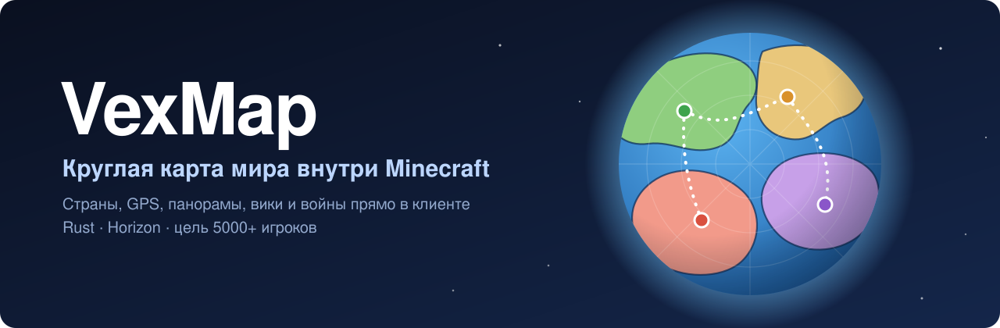
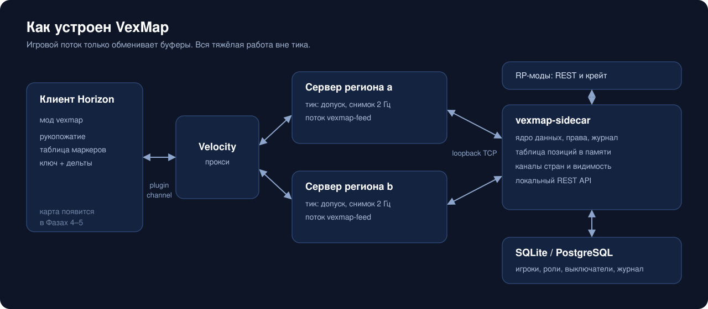
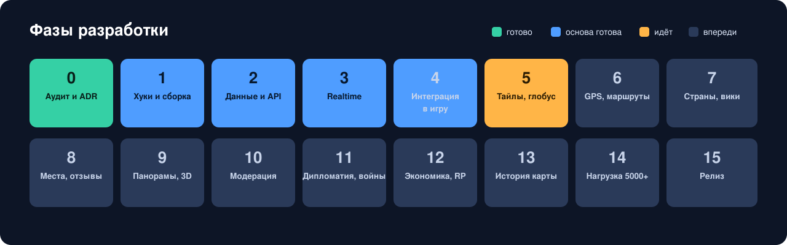
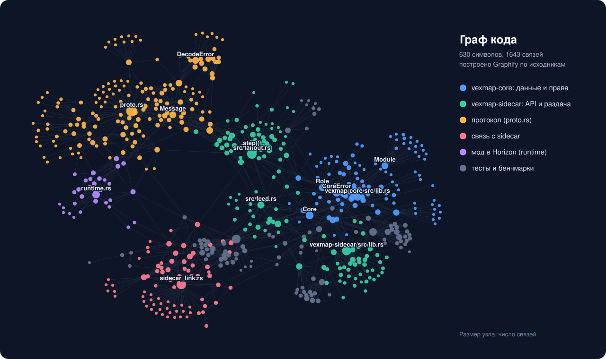

<p align="center">
  
</p>

<p align="center">
  <a href="https://github.com/babmax/vexmap/actions/workflows/ci.yml"></a>
  <a href="LICENSE"></a>
  
  
  
</p>

**VexMap** это функциональный аналог Google Maps и Google Earth для ролевого мира на [Horizon](https://github.com/horizon-rust/horizon), Rust-версии Minecraft Java 26.3.
Нативный мод для клиента и серверов регионов: круглая карта и 3D-глобус, GPS, страны и границы, места с отзывами, панорамы улиц, вики, дипломатия и войны. Всё внутри игры, без сайта.

> [!NOTE]
> Проект в разработке, идёт Фаза 5 из 15. Карта уже показывает настоящий мир: глобус, круглая и плоская карта, тема день/ночь, миникарта на тайлах. GPS, страны и места впереди.

## Что уже работает

| | |
|---|---|
| **Допуск** | Только клиенты с модом, рукопожатие проходит через прокси Velocity и переходы между серверами |
| **Данные** | Игроки, роли, страны, выключатели модулей и журнал изменений на SQLite и PostgreSQL |
| **Локальный API** | REST для RP-модов, только loopback, с лимитами и идемпотентностью |
| **Позиции** | Снимок 2 Гц, кванты 1/8 блока, ключевые кадры и дельты |
| **Видимость** | Участник страны видит свою страну, модераторы и выше видят всех. Решает сервер |
| **Ресурс-пак** | Обязательный пак с оригинальными значками, отказ и сбой загрузки обрабатываются при входе |
| **Интерфейс** | Клавиша M, команда `/map` и кнопка в меню паузы открывают карту. Миникарта, 6 пресетов, настройки клавиш, русский и английский |
| **Масштаб** | Большие каналы делятся на клетки и кластеры: 1,9 КБ/с на зрителя в симуляции канала на 5000 игроков |
| **Карта мира** | Тайлы из файлов региона, глобус без швов, круглая и плоская карта, день и ночь |
| **Изоляция** | Тик не ждёт сеть и базу. Sidecar упал, а игра продолжается |
| **Релизы** | Подпись minisign и воспроизводимые архивы |

Замеры, стендовые тесты и нерешённые вопросы лежат в [docs/phase-3](docs/phase-3/README.md) и [docs/phase-4](docs/phase-4/README.md).

## Архитектура

<p align="center">
  
</p>

Ключевые решения и их альтернативы записаны как ADR: [аудит Horizon](docs/phase-0/audit.md), [Фаза 0](docs/phase-0/adr.md), [Фаза 2](docs/phase-2/README.md), [Фаза 3](docs/phase-3/README.md), [Фаза 4](docs/phase-4/README.md).

## Фазы

<p align="center">
  
</p>

## Устройство кода

<p align="center">
  
</p>

```text
mods/vexmap/                 бандл horizon-mixins: один мод на клиент и сервер
  compatibility.json         пин Horizon и horizon-mixins
  mixins/vexmap/proto.rs     протокол, только std, он же крейт vexmap-proto
  mixins/vexmap/runtime.rs   связь с API Horizon
  mixins/vexmap/ui.rs        логика интерфейса, только std, она же крейт vexmap-ui
  mixins/vexmap/map_screen.rs окно карты и миникарта через хелперы GUI
crates/vexmap-proto/         Cargo-обёртка над proto.rs для тестов и sidecar
crates/vexmap-core/          игроки, роли, страны, выключатели модулей, журнал изменений
crates/vexmap-sidecar/       отдельный процесс: REST API, приём игроков, раздача позиций
crates/vexmap-link/          Cargo-обёртка над sidecar_link.rs: связь сервера региона с sidecar
crates/vexmap-resourcepack/  сборка ресурс-пака, все изображения рисуются кодом
tools/dev/stage.py           применить мод к Horizon и запустить cargo (Windows и Linux)
tools/release/sign.py        архивы релиза, SHA256SUMS, подпись minisign
```

## Быстрый старт

```sh
cargo test --workspace                                # протокол, ядро и sidecar, без сборки игры
python tools/dev/stage.py check mods/vexmap           # мод внутри настоящего Horizon
python tools/dev/stage.py build mods/vexmap           # клиент с модом, профиль fast
cargo run -p vexmap-sidecar                           # локальный API на 127.0.0.1:7878, база SQLite рядом
```

`stage.py` ждёт рядом `.deps/horizon-mixins` на ревизии из `compatibility.json`.

## Проверка релиза

Релизы подписаны [minisign](https://jedisct1.github.io/minisign/). Публичный ключ лежит в [vexmap.pub](vexmap.pub):

```text
RWSFNDOgqs3Sr6jDLI06gzKF/1NtoK6CV9S14KIx65gPS+KLqHTvWn5o
```

```sh
minisign -Vm SHA256SUMS -p vexmap.pub
sha256sum -c SHA256SUMS
```

## Лицензия

[MIT](LICENSE). Код и изображения в этом репозитории оригинальные. Файлы игры и ассеты Mojang сюда не входят: игроку нужен свой аккаунт с Java Edition.
